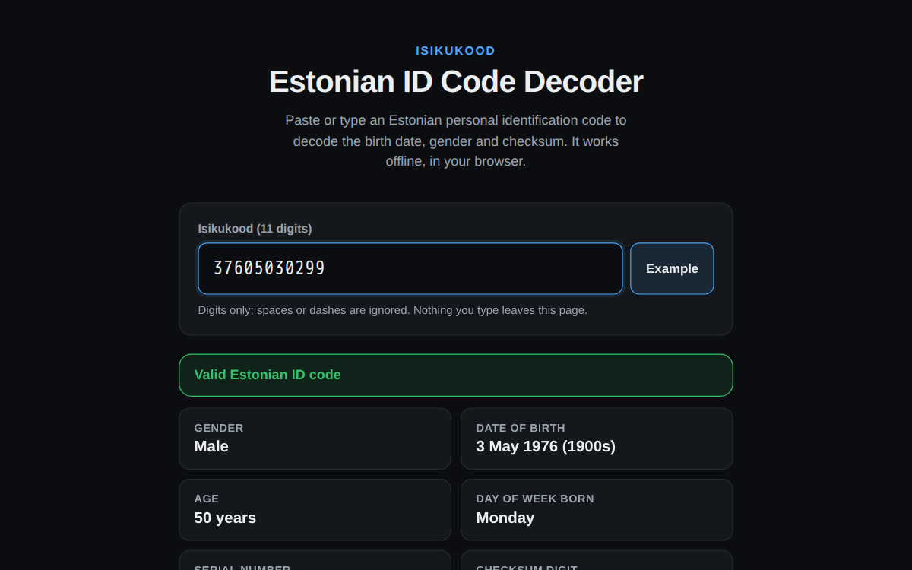

# Estonian ID Code Decoder

A tiny, dependency-free single-page app that decodes an Estonian personal
identification code (*isikukood*): gender, date of birth, age, and checksum
validity. Everything runs in the browser: no network requests, no backend, and
nothing you type leaves the page.

**Live:** https://gren-95.github.io/estonian-id-decoder/



## How the code is structured

An isikukood is 11 digits: `G YYMMDD SSS C`

| Part | Meaning |
|------|---------|
| `G` | Century + gender: 1/2 = male/female born 1800-1899, 3/4 = 1900-1999, 5/6 = 2000-2099, 7/8 = 2100-2199 |
| `YYMMDD` | Date of birth |
| `SSS` | Serial number that tells apart people born the same day. Before 2013 it also encoded the hospital of birth |
| `C` | Checksum digit, a weighted mod-11 check over the first 10 digits |

## Running locally

No build step. Just serve the directory statically, e.g.:

```bash
python3 -m http.server 8080
# then open http://localhost:8080
```

Or simply open `index.html` directly in a browser.

## Deployment

The site is served by GitHub Pages straight from `main` (root folder). There
is no build step or workflow: push to `main` and Pages republishes it.

## Privacy note

This tool only parses the public, self-describing structure of the code
(it's not a lookup or a database). Nothing typed into the input is sent
anywhere; open your browser's Network tab to confirm.

## Licence

MIT, see [LICENSE](LICENSE).
